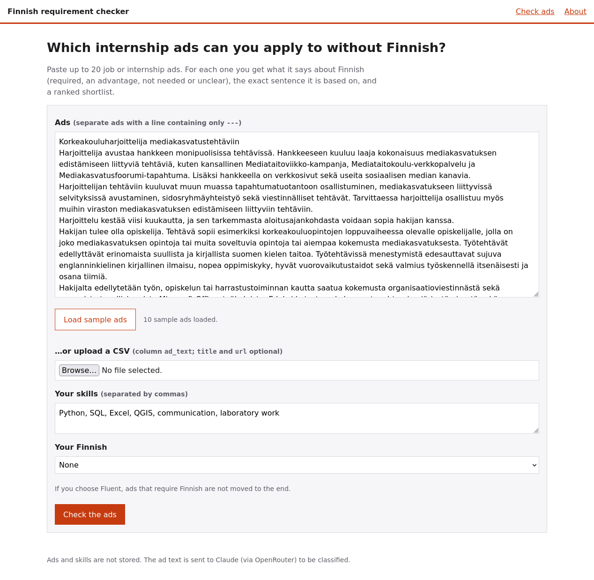
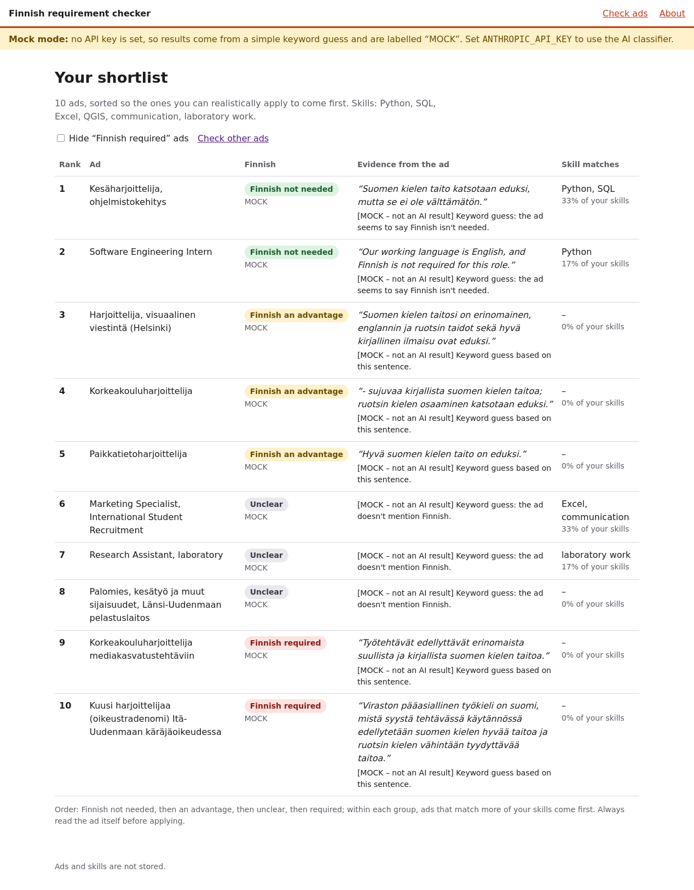
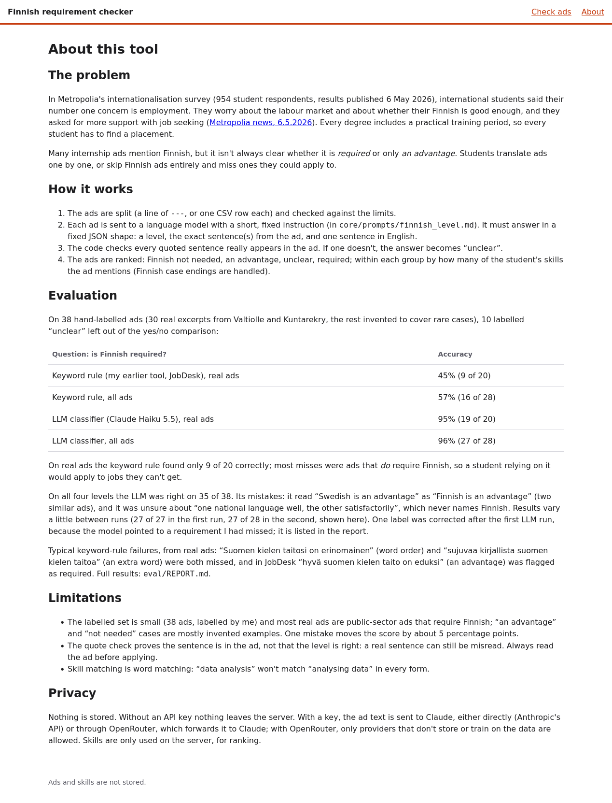

# Finnish requirement checker for internship ads

A small Flask app that reads a batch of job or internship ads and tells an international student, for each ad,
whether Finnish is **required**, **an advantage**, **not needed** or **unclear**. Each answer comes with the exact
sentence from the ad it is based on. The app then returns a ranked shortlist of the ads they can realistically
apply to.

## The problem

In Metropolia's internationalisation survey (954 student respondents; results published on 6 May 2026),
international students said their **number one concern is employment**. They are worried about the labour market
and about **whether their Finnish language skills are sufficient**, and they asked for **more support with job
seeking** ([Metropolia news, 6.5.2026](https://www.metropolia.fi/en/about-us/news/metropolias-international-students-are-satisfied-with-teaching-and-support-and-wish-to-stay-and-work-in-finland)).
A practical training period is part of every Metropolia degree, so every student has to find a placement. Many
internship ads mention Finnish, but students can't easily tell whether it is truly required or only "an advantage".
So they translate ads one by one, or skip Finnish ads entirely and miss ones they could apply to.

## Screenshots

| Input | Results | About |
|---|---|---|
|  |  |  |

The screenshots show **live results** (Claude Haiku 5.5 via OpenRouter) for the 10 sample ads. Without a key,
the app runs in mock mode instead: a simple keyword guess, labelled "MOCK" on every result.

## How it works

```
 ads (pasted, separated by ---, or a CSV)  +  your skills  +  your Finnish level
        │
        ▼
 1. split and check limits ............ core/batch.py   (max 20 ads, 10,000 characters each)
        │
        ▼
 2. classify each ad .................. core/finnish.py (LLM with a fixed JSON answer shape; mock mode without a key)
        │       {"level": "preferred", "evidence": ["Suomen kielen taito katsotaan eduksi."], "explanation_en": "…"}
        ▼
 3. check the quote ................... core/finnish.py (is every quoted sentence really in the ad? if not → "unclear")
        │
        ▼
 4. rank .............................. core/rank.py    (not needed → an advantage → unclear → required,
        │                                                 then by how many of your skills the ad mentions)
        ▼
 results table with badges, quotes, explanations, skill matches and a "hide Finnish required" filter
```

## Why an LLM and not just keywords

My earlier tool, **JobDesk**, used one regular expression to flag Finnish as a "blocker". It flagged
*"hyvä suomen kielen taito on eduksi"* ("good Finnish skills are an advantage") as **required**, because it only
looked for "good … Finnish". That rule is kept here unchanged as `baseline_v1`, and the evaluation measures it on
real ads.

**Results on 38 hand-labelled ads** (30 real excerpts from Valtiolle and Kuntarekry, 8 invented to cover cases the
real ads lacked). For the yes/no question "is Finnish required?", the 10 ads labelled "unclear" are left out:

| Classifier | Accuracy, real ads | Accuracy, all ads |
|---|---|---|
| `baseline_v1` (JobDesk's keyword rule) | 45% (9 of 20) | 57% (16 of 28) |
| LLM classifier (Claude Haiku 5.5 via OpenRouter) | **95%** (19 of 20) | **96%** (27 of 28) |

On all four levels (required / an advantage / not needed / unclear) the LLM was right on **35 of 38** (92%).

On real ads the keyword rule **found only 8 of the 19 ads that require Finnish**. A student relying on it would apply
to jobs they can't get. Its typical misses are ordinary sentences that are only slightly different from its patterns:

| Real ad sentence | Why the regex misses it |
|---|---|
| "Suomen kielen taitosi on erinomainen, englannin ja ruotsin taidot … ovat eduksi." | word order (Finnish first, "excellent" last) |
| "sujuvaa kirjallista suomen kielen taitoa; ruotsin kielen osaaminen katsotaan eduksi." | an extra word ("written") between "fluent" and "Finnish" |
| "edellytämme hyvää suomen ja käytännön ruotsin ja englannin kielen taitoa" | "Finnish" and "language" are far apart |
| "Kielitaitovaatimuksena toisen kotimaisen kielen hyvä … ja toisen kotimaisen kielen tyydyttävä … taito." | "the national languages": Finnish isn't named at all |

Covering every phrasing with more rules quickly becomes a maze. A language model reads the sentence the way a
person does, and the quote check keeps it honest. Full report: [`eval/REPORT.md`](eval/REPORT.md).

**Where the LLM still goes wrong** (all three are real ads):

| Ad sentence | Label | LLM said | What went wrong |
|---|---|---|---|
| "…poliisilaitos on kaksikielinen, joten hakijalle voidaan katsoa eduksi, että hän kykenee tulkitsemaan ruotsinkielisiä asiakirjoja." | unclear | an advantage | Only *Swedish* is an advantage; the model read it as Finnish (twice, in two similar ads) |
| "Kielitaitovaatimuksena toisen kotimaisen kielen hyvä … ja toisen kotimaisen kielen tyydyttävä … taito." | required | unclear | "One national language well, the other satisfactorily" never names Finnish. The model got it right in the first run and wrong in the second. |

**Honest notes on these numbers**
- **The set is small and mostly my own labels.** A 95% on 20 real ads means one mistake; it shows the direction, not
  a precise rate.
- **Results vary between runs.** The first run scored 27 of 27 on the yes/no question, the second 27 of 28 (the
  `real-24` case above). The numbers above are from the second run.
- **One label was corrected after the first LLM run.** I had labelled `real-46` "unclear". The model said "required",
  and on rereading, the ad does state the same national-languages requirement as `real-24`. I changed the label and
  recorded it in the data (`corrected_after_llm_run`) and in the report. Changing labels after seeing the model's
  answers can flatter it, so every such change is listed.
- **Only Claude Haiku 5.5 (the cheapest model) was evaluated.** The app's default, Claude Opus 5.5, wasn't measured.

## Why not just paste the ads into ChatGPT?

- **Batch:** 20 ads at once, as a table, instead of one conversation per ad.
- **Ranking:** the ads are sorted by what matters to the student: Finnish level first, then skill matches.
- **Verified quotes:** every answer cites a sentence, and the code checks that sentence is really in the ad. An
  invented quote turns the answer into "unclear" instead of being trusted.
- **Measured:** accuracy is measured on a labelled set and compared with a baseline, with every disagreement listed.
- **Fixed rules:** the same written instructions (`core/prompts/finnish_level.md`) for every ad and every student.

## Setup and run

Python 3.11 or newer.

```bash
python3 -m venv .venv && source .venv/bin/activate
pip install -r requirements.txt
flask --app app run --port 5050  # http://localhost:5050
```

Port 5050, because on macOS port 5000 belongs to AirPlay Receiver (the browser shows "403 access denied").

- **Without an API key** the app runs in **mock mode**: a simple keyword guess, labelled "MOCK" everywhere, so you can
  try the app immediately. Click **Load sample ads**, then **Check the ads**.
- **With an API key:** `cp .env.example .env`, then set **one** of the two keys and restart:
  - `ANTHROPIC_API_KEY` (Anthropic's API directly), or
  - `OPENROUTER_API_KEY` (OpenRouter, which forwards requests to Claude).

  Optional settings: `LLM_MODEL` (default `claude-opus-5-5`; Anthropic-style names are converted for OpenRouter, e.g.
  `claude-haiku-5-5` → `anthropic/claude-haiku-5.5`), `LLM_EFFORT` (default `low`, Anthropic API only), and
  `LLM_MODE=mock` to force mock mode.

Tests and evaluation:

```bash
python -m pytest            # routes, mock mode, quote check, CSV validation, ranking
python -m core.evaluate     # writes eval/REPORT.md and eval/summary.json (mock mode without a key)
```

## Design decisions

- **Structured output:** the model must answer in a fixed JSON schema (level, evidence, explanation), so the app
  never has to parse free text.
- **The quote check is in code, not in the prompt:** asking a model "are you sure?" is not a check. A substring test
  is.
- **Unclear rather than a guess:** an ad that says nothing about Finnish is "unclear", not "not needed". Telling a
  student "Finnish not needed" on a guess would do more harm than saying "check the ad".
- **Required ads are sorted last, not hidden:** the student decides (there's a filter), and a student with fluent
  Finnish can turn the ordering off.
- **Plain code, standard library where possible:** the API is called with `urllib`; the only dependencies are Flask
  and python-dotenv (plus pytest for tests).
- **Vendored code:** `core/` is copied from my JobDesk project and trimmed. Only the classifier, the batch reader,
  ranking, the word helpers and the evaluation were copied. No user data, CVs, database or scraper code.

## Limitations and known failure cases

- **Small labelled set.** 38 ads, and most real ones are public-sector internships that require Finnish. The
  "an advantage" and "not needed" cases are mostly invented examples, marked as such in `data/eval/ads.jsonl`.
- **The quote check can't catch a misread.** It proves the sentence is in the ad, not that the level is right
  (for example, a real "is an advantage" sentence labelled "required").
- **Hard cases:** an ad that says there are "no formal language requirements" and then that good Finnish is needed;
  "good skills in one national language and satisfactory in the other". These are in the evaluation set.
- **Skill matching is word matching.** It handles Finnish case endings ("paikkatieto" ↔ "paikkatietoaineistoista"),
  but not synonyms.
- **The labels are mine**, following `data/eval/GUIDE.md`. A second labeller would make the numbers more reliable.

## Privacy

Nothing is stored: no database, no files, no logs of the ads. In mock mode nothing leaves the server. With a key,
the **ad text** is sent to Claude to be classified: either directly (Anthropic's API) or through OpenRouter. With
OpenRouter, the request only allows providers that don't store or train on the data (`data_collection: "deny"`). The
student's skills and Finnish level are only used on the server, for ranking.

## With more time

- Grow the labelled set (a second labeller, more private-sector ads), evaluate the default model (Opus 5.5)
  as well as Haiku, and report the average of several runs instead of one.
- Let students paste a link instead of the text (respecting each site's robots.txt and terms).
- Remember a student's skills between visits (with consent), and add Finnish and Swedish versions of the interface.
- Apply for Työmarkkinatori's official job-ad API, rather than collecting ads by hand.

## Where things are

`app.py` routes · `core/` logic · `templates/` pages · `static/` CSS and the small JavaScript · `data/samples.json`
the 10 sample ads · `data/eval/` the labelled ads and labelling guide · `eval/` the report · `tests/` pytest ·
`docs/EXPLAINED.md` a walk-through of every file.

The sample ads and evaluation excerpts are short quotations from public job ads (sources linked in the data
files, collected on 24 November 2026 from sites whose robots.txt allows it). Invented examples are marked.
